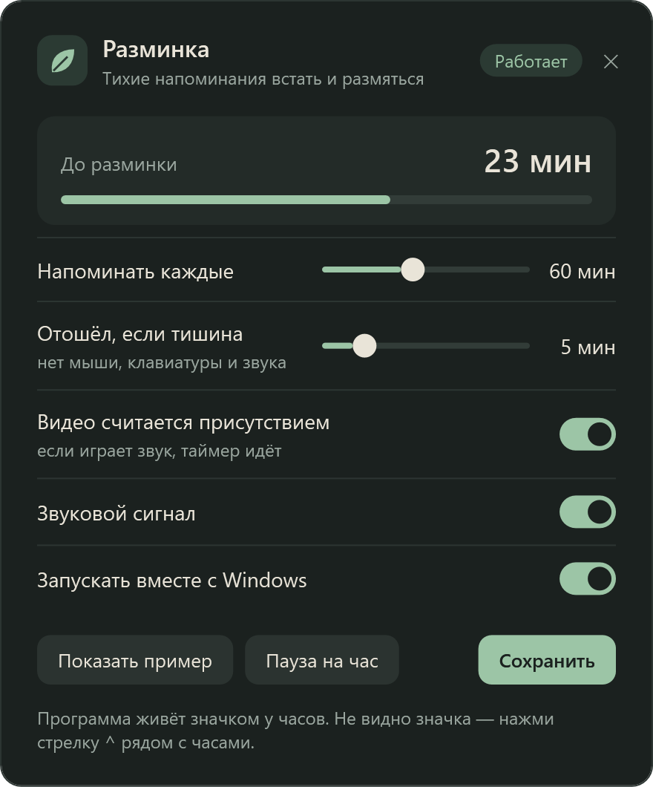

# quiet-break-reminder

**RU** | [EN](#english)

Тихая напоминалка размяться для Windows. Раз в час активной работы показывает обычное уведомление в углу экрана и играет короткий звук. Никаких окон посреди экрана и обязательных 5-минутных перерывов: можно спокойно доиграть катку или дописать код, а размяться чуть позже.

<p align="center"></p>

## Как работает

- Живёт значком с листиком у часов. Наведи мышь — увидишь, сколько осталось до разминки. Клик — окно настроек. Правый клик — меню: «Напомнить сейчас», «Пауза на час» (рейтинговая катка, созвон), «Настройки», «Выход».
- В окне настроек: интервал напоминаний, через сколько минут тишины считать, что ты отошёл, учитывать ли звук от видео, звуковой сигнал и запуск вместе с Windows.
- Считает только время, когда ты за компьютером. Если на компьютере играет звук (смотришь видео или стрим), это тоже считается: таймер не сбрасывается, даже если мышь лежит без дела. Отсчёт начинается заново, только если несколько минут (по умолчанию 5) нет ни мыши с клавиатурой, ни звука — значит, отошёл.
- Уведомление само пропадает примерно через 25 секунд. В тексте каждый раз новый совет: присесть, размять шею, посмотреть вдаль и т.п.
- Звук играет отдельно от уведомления, поэтому его слышно, даже когда Windows прячет уведомления во время полноэкранной игры.
- Работает в фоне без окна консоли. Чистый PowerShell и встроенный в Windows WPF, ничего ставить не нужно.
- Ведёт лог `razminka.log` рядом со скриптом: когда сбрасывался таймер и когда показывалось напоминание.

## Нагрузка и приватность

**На FPS в играх не влияет.** Замер на 12-поточном процессоре во время работы: около 125 мс процессорного времени за 30 секунд, то есть примерно **0,03% CPU**. Память — до ~180 МБ: это сам PowerShell и графическая библиотека Windows для окна настроек.

Что программа делает на самом деле:

| Как часто | Что | Как |
|---|---|---|
| раз в секунду | узнаёт, играет ли сейчас звук | спрашивает у Windows текущий уровень громкости на выходе — одно число, то же, что показывает индикатор в микшере |
| раз в секунду | узнаёт, когда последний раз двигалась мышь или нажималась клавиша | `GetLastInputInfo` — Windows хранит только время последнего ввода |
| раз в час | показывает уведомление и играет звук | стандартные уведомления Windows |

Остальное время программа спит.

Чего программа **не** делает:

- не смотрит на экран и не делает скриншотов;
- не записывает и не слушает звук и микрофон — знает только громкость на выходе, без содержимого;
- не знает, какие клавиши нажимались, — только время последнего нажатия;
- не ходит в интернет;
- не требует прав администратора.

Весь код — в одном файле [`razminka.ps1`](razminka.ps1), его легко проверить самому.

Проверить нагрузку у себя (PowerShell):

```powershell
$p = Get-CimInstance Win32_Process -Filter "Name='powershell.exe'" | ? CommandLine -like '*razminka.ps1*' | select -First 1
$pr = Get-Process -Id $p.ProcessId; $a = $pr.TotalProcessorTime; sleep 20; $pr.Refresh()
"CPU: {0:N3}%" -f (($pr.TotalProcessorTime - $a).TotalMilliseconds / 20000 / [Environment]::ProcessorCount * 100)
```

## Установка

1. Скачай репозиторий (**Code → Download ZIP**) и распакуй в постоянную папку.
2. Запусти `install.cmd`.

Готово: напоминалка запущена, у часов появился значок с листиком, и откроется окно настроек. В меню «Пуск» появится ярлык «Разминка» — он открывает настройки. Программа будет стартовать сама при входе в Windows (это можно выключить в настройках).

Если значка у часов не видно, нажми стрелку ^ рядом с часами. Чтобы значок был виден всегда, перетащи его оттуда на панель задач.

Проверить, как выглядит уведомление: кнопка «Показать пример» в настройках или

```powershell
powershell -ExecutionPolicy Bypass -File .\razminka.ps1 -Test
```

## Удаление

Запусти `uninstall.cmd`. Он уберёт автозапуск и ярлык из «Пуска» и остановит напоминалку. Потом можно удалить папку.

## Требования

Windows 10/11 и встроенный Windows PowerShell 5.1.

---

## English

A quiet stretch-break reminder for Windows. After every hour of active computer use it shows a regular notification in the corner of the screen and plays a short sound. No window in the middle of your screen and no forced 5-minute breaks: finish your match or your task, then stretch.

<p align="center"></p>

The interface and notifications are in Russian.

### How it works

- Lives as a leaf icon next to the clock. Hover to see how long until the next break. Click to open settings. Right-click for a menu: remind now, pause for an hour (ranked match, a call), settings, exit.
- Settings: reminder interval, how many quiet minutes mean you walked away, whether video sound counts as presence, the reminder sound, and starting with Windows.
- Only time you actually spend at the computer counts. Sound playing on the PC (watching a video or a stream) counts as being there too, so the timer keeps going even when the mouse sits still. The timer resets only after a few minutes (5 by default) with neither input nor sound — you walked away.
- The notification disappears on its own after about 25 seconds and shows a random stretching tip (edit `$tips` in `razminka.ps1` to change them).
- The sound plays separately from the notification, so you hear it even when Windows hides notifications during fullscreen games.
- Runs in the background with no console window. Pure PowerShell plus the WPF built into Windows, nothing to install.
- Writes a log to `razminka.log` next to the script: timer resets and reminders shown.

### Performance and privacy

**No effect on in-game FPS.** Measured on a 12-thread CPU while running: about 125 ms of CPU time per 30 seconds, roughly **0.03% CPU**. Memory is up to ~180 MB: the PowerShell runtime plus the Windows UI library for the settings window.

What it actually does:

| How often | What | How |
|---|---|---|
| every second | checks whether sound is playing | asks Windows for the current output peak level — a single number, the same one the volume mixer meter shows |
| every second | checks when the mouse/keyboard was last used | `GetLastInputInfo` — Windows only stores the time of the last input |
| every hour | shows a notification and plays a sound | standard Windows notifications |

The rest of the time it sleeps.

What it does **not** do:

- no screen capture or screenshots;
- no audio or microphone recording — it only reads the output level, not the content;
- no keylogging — only the time of the last input;
- no network access;
- no admin rights required.

All the code is in a single file, [`razminka.ps1`](razminka.ps1), easy to review yourself. The PowerShell snippet in the Russian section above measures CPU usage on your machine.

### Install

1. Download the repo (**Code → Download ZIP**) and extract it to a permanent folder.
2. Run `install.cmd`.

That's it: the reminder is running, a leaf icon appears next to the clock, and the settings window opens. A Start menu shortcut named "Разминка" opens settings later. It starts automatically when you sign in to Windows (you can turn that off in settings).

If you don't see the icon, click the ^ arrow next to the clock; drag the icon to the taskbar to keep it visible.

Preview the notification with the "Показать пример" button in settings, or:

```powershell
powershell -ExecutionPolicy Bypass -File .\razminka.ps1 -Test
```

### Uninstall

Run `uninstall.cmd`. It removes autostart and the Start menu shortcut and stops the reminder. Then you can delete the folder.

### Requirements

Windows 10/11 with the built-in Windows PowerShell 5.1.

## License

[MIT](LICENSE)
